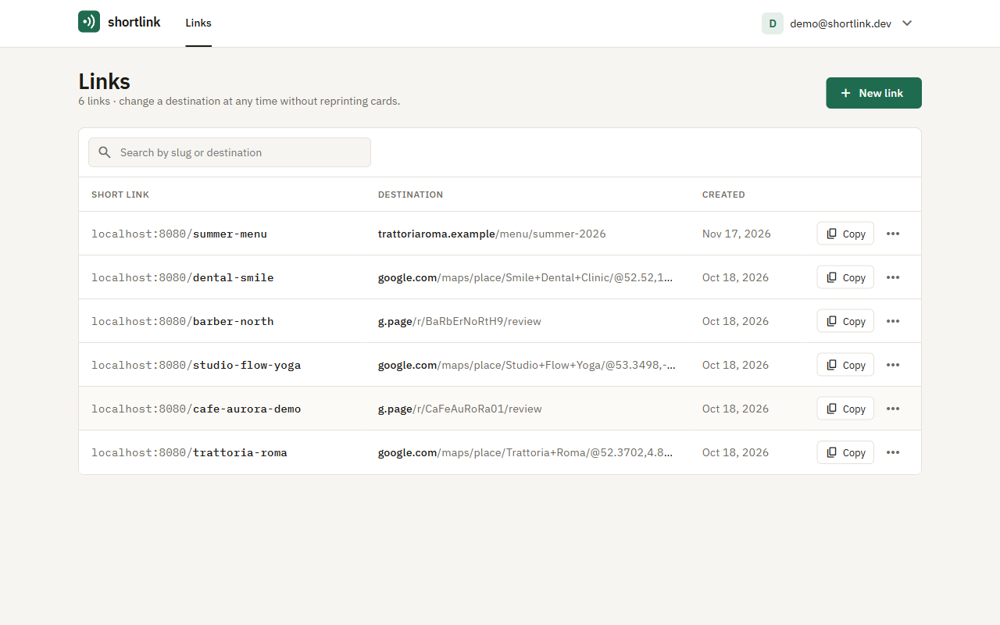
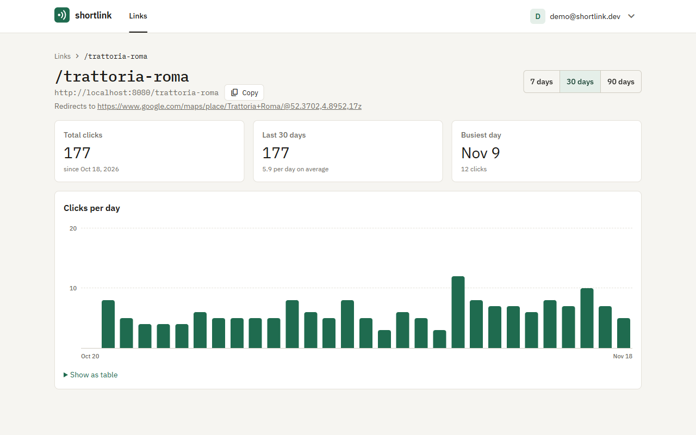
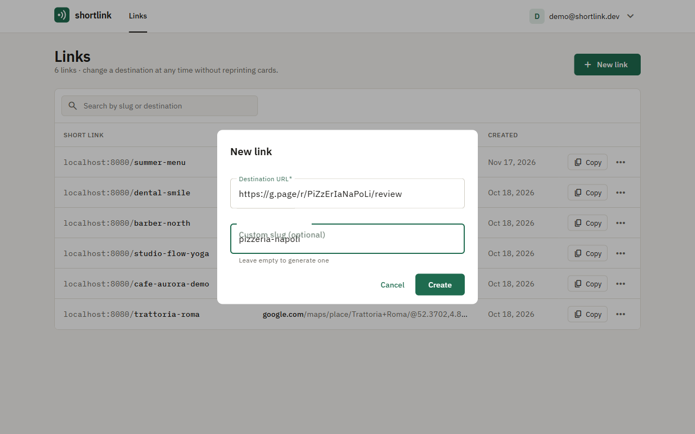
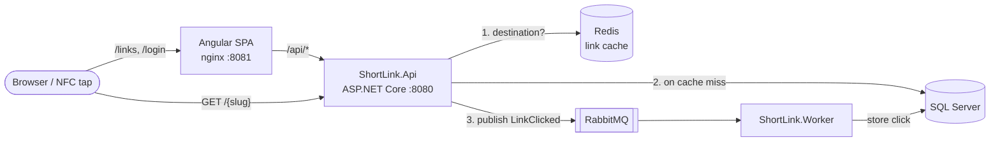

# ShortLink

A URL shortener with click analytics, built with **.NET 10** and **Angular 22**.

It started from a real need: I sell NFC cards that send customers to a business's Google review page. Writing a Google URL straight onto a card means the card is useless the day that URL changes. ShortLink puts a short link on the card instead, so the destination can be changed at any time without reprinting anything, and every tap is counted.



| Click analytics | Creating a link |
|---|---|
|  |  |

## Features

- Short links with a custom or generated slug, and a destination that can be changed later
- Fast public redirects (`GET /{slug}` → `302`), cached in Redis
- Click tracking processed asynchronously through RabbitMQ, so it never slows a redirect down
- Per-link analytics: total clicks, clicks per day (7, 30 or 90 days), busiest day
- Accounts with ASP.NET Identity and JWT; each user only sees and manages their own links
- Health checks, rate limiting and circuit breakers so the redirect keeps working when Redis or RabbitMQ are down
- Angular dashboard: search, copy, edit and delete links, plus a dependency-free bar chart

## Architecture



A redirect does as little as possible on the request path: it reads the destination from Redis (falling back to SQL Server on a miss), publishes a `LinkClicked` event and returns the `302`. The Worker consumes the event and stores the click, with retries.

The backend follows Clean Architecture:

| Project | Responsibility |
|---|---|
| `ShortLink.Domain` | Entities and rules (`Link`, `Click`, slug validation), no dependencies |
| `ShortLink.Application` | Use cases (`LinkService`, `ClickService`) and the ports they need (`ILinkRepository`, `ILinkCache`, `IClickTracker`) |
| `ShortLink.Infrastructure` | EF Core, Redis, MassTransit/RabbitMQ, Identity, JWT, resilience pipelines, health checks |
| `ShortLink.Contracts` | Messages shared by the API and the Worker |
| `ShortLink.Api` | Minimal API endpoints, authentication, rate limiting, error handling |
| `ShortLink.Worker` | Background consumer that records clicks |

## Tech stack

**Backend:** .NET 10, ASP.NET Core Minimal APIs, EF Core 10, SQL Server 2025, ASP.NET Identity, JWT, Redis, RabbitMQ with MassTransit, Polly (`Microsoft.Extensions.Resilience`), OpenAPI with Scalar

**Frontend:** Angular 22 (standalone components, signals, zoneless), Angular Material, RxJS

**Infrastructure:** Docker Compose, nginx

## Design decisions

- **Clicks are processed asynchronously.** The redirect is the hot path, so it only publishes an event; writing to the database happens in the Worker.
- **Cache-aside with explicit invalidation.** Destinations are cached for 24 hours and evicted when a link is edited, so a changed destination takes effect immediately.
- **No IP addresses are stored.** A click keeps only the timestamp, user agent and referrer, which is enough for the analytics and keeps the data GDPR-friendly.
- **Another user's link returns `404`, not `403`.** That way the API does not reveal which link IDs exist. Login likewise returns the same `401` for an unknown email and a wrong password.
- **Errors use ProblemDetails (RFC 9457)** across the API, including validation, conflicts (`409` for a slug already in use) and rate limiting (`429`).
- **Slugs are validated in the domain:** 3 to 32 lowercase letters, digits and single hyphens, with reserved words (`api`, `health`, `openapi`) blocked.
- **Time comes from `TimeProvider`**, and IDs are UUIDv7 (time-ordered, index-friendly).

## Resilience

Measured with Docker Compose by stopping each dependency while the app was running:

| Dependency down | Redirects | `/health/ready` |
|---|---|---|
| Redis | Keep working from SQL Server. After the circuit breaker opens (2 failures), back to ~20 ms | `Degraded` (200) |
| RabbitMQ | Keep working; clicks during the outage are dropped. Publish is capped at 2 s, then the circuit opens | `Degraded` (200) |
| SQL Server | Fail | `Unhealthy` (503), and the container is marked unhealthy |

- **Redis cache:** a circuit breaker, plus short client timeouts. A Polly timeout cannot help here because the Redis client ignores cancellation while connecting.
- **Click publishing:** a total timeout, retry with exponential backoff and jitter, a circuit breaker and a per-attempt timeout.
- **Database:** EF Core retry on transient failures. The Worker also retries failed messages.
- **Rate limiting:** login and registration allow 5 requests per minute per IP (brute-force protection), and redirects allow 120 per minute per IP. The client IP is read from `X-Forwarded-For` behind nginx.
- **Health checks:** `/health/live` (the process is up) and `/health/ready` (SQL Server, Redis and RabbitMQ). Docker Compose starts the Worker and the frontend only once the API is ready.

## Getting started

You only need [Docker Desktop](https://www.docker.com/products/docker-desktop/).

```bash
git clone https://github.com/devfilip1/NFCTrack.git
cd NFCTrack
cp .env.example .env        # set your own passwords and a random JWT key (32+ characters)
docker compose up -d --build
```

Database migrations run automatically on startup. Then open:

| What | URL |
|---|---|
| Dashboard (create an account there) | http://localhost:8081 |
| API reference (Scalar) | http://localhost:8080/scalar |
| Health | http://localhost:8080/health/ready |
| RabbitMQ management | http://localhost:15672 |

To work on the frontend with hot reload, keep the containers running and start the Angular dev server. It proxies `/api` to the API on port 8080:

```bash
cd Client
npm install
npm start                   # http://localhost:4200
```

## API

| Method | Route | Auth | Description |
|---|---|---|---|
| `POST` | `/api/auth/register` | — | Create an account, returns a JWT |
| `POST` | `/api/auth/login` | — | Sign in, returns a JWT |
| `GET` | `/api/links` | JWT | List your links |
| `POST` | `/api/links` | JWT | Create a link (`destinationUrl`, optional `slug`) |
| `GET` | `/api/links/{id}` | JWT | Get one of your links |
| `PUT` | `/api/links/{id}` | JWT | Change the destination |
| `DELETE` | `/api/links/{id}` | JWT | Delete a link and its clicks |
| `GET` | `/api/links/{id}/stats?days=30` | JWT | Total clicks and clicks per day (1–365 days) |
| `GET` | `/{slug}` | — | Redirect to the destination (`302`) |
| `GET` | `/health/live`, `/health/ready` | — | Liveness and readiness |

## Roadmap

- Automated tests (xUnit, Testcontainers) and a CI pipeline with GitHub Actions
- Transactional outbox so clicks are not lost while RabbitMQ is down
- JWT authentication in the Scalar API reference
- Refresh tokens, or an HttpOnly cookie instead of `localStorage`
- Trust `X-Forwarded-For` only from the reverse proxy (it currently trusts any sender, which is fine for local development only)
- Public deployment
- QR code generation and click counts on the links list
